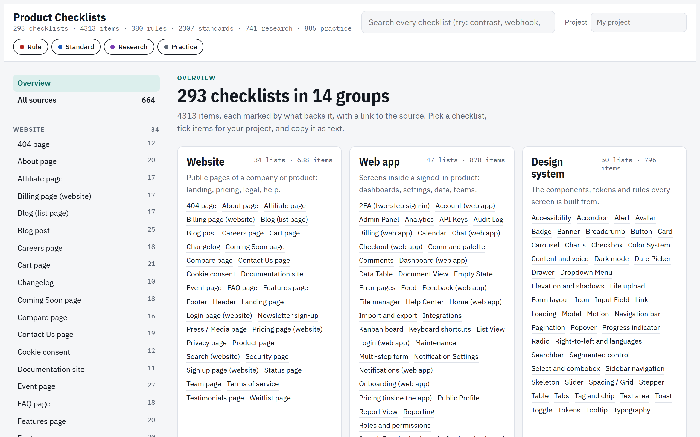
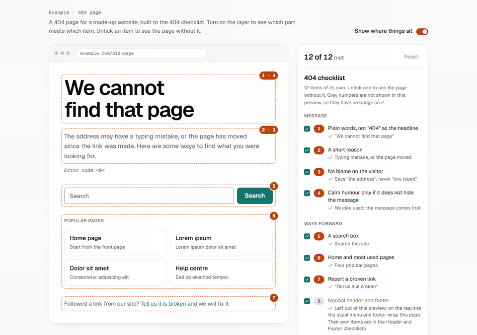

# Product Checklists

**293 checklists, 4,313 items, every item backed by a source.** One checklist for each thing you build
(a 404 page, a login screen, a modal, an API, a release note). Each item is marked by what backs it:
a **rule** (law or platform rule), a **standard** (WCAG, OWASP, NIST...), **research**, or common **practice**.

### Try it live

| | |
|---|---|
| **[Open the checklists](https://smalibary.github.io/product-checklists/checklists/)** | Search all 293 checklists, tick items for your project, copy them as text. |
| **[Open the live examples](https://smalibary.github.io/product-checklists/)** | Real pages built to a checklist. Untick an item and watch the page break. |

GitHub can't run a page inside this readme, so the links above open the working site.



## Live examples: tick and untick to see what each item does

Each example is a small, made-up page built to one checklist. Turn on **Show where things sit** to see which
part of the page meets which item. Untick an item and the page changes to the version without it, so you
see why the item matters.



| Group | Example | Status |
|---|---|---|
| Website | [404 page](https://smalibary.github.io/product-checklists/examples/404/) | Live |
| Flows | [Resetting a password](https://smalibary.github.io/product-checklists/examples/resetting-password/) | Live |
| Web app | [Dashboard](https://smalibary.github.io/product-checklists/examples/dashboard/) | Live |
| Mobile | [Login](https://smalibary.github.io/product-checklists/examples/mobile-login/) | Live |
| Design system | [Modal](https://smalibary.github.io/product-checklists/examples/modal/) | Live |
| API | [API docs](https://smalibary.github.io/product-checklists/examples/api-docs/) | Live |
| Backend | [Search](https://smalibary.github.io/product-checklists/examples/search/) | Live |
| Code | [Readme and docs](https://smalibary.github.io/product-checklists/examples/readme-docs/) | Live |
| Growth | [Blog](https://smalibary.github.io/product-checklists/examples/blog/) | Live |
| Launch | [Legal pages](https://smalibary.github.io/product-checklists/examples/legal-pages/) | Live |
| Motion | [Micro-interactions](https://smalibary.github.io/product-checklists/examples/micro-interactions/) | Live |
| Operations | [Monitoring and alerts](https://smalibary.github.io/product-checklists/examples/monitoring-alerts/) | Live |
| Product | [Release announcements](https://smalibary.github.io/product-checklists/examples/release-announcements/) | Live |
| Support | [Help desk](https://smalibary.github.io/product-checklists/examples/help-desk/) | Live |

### Shared parts

Every example uses one standard set of parts, each built to its own checklist and shown on its own page:
[header](https://smalibary.github.io/product-checklists/parts/header/) ·
[footer](https://smalibary.github.io/product-checklists/parts/footer/) ·
[button and button group](https://smalibary.github.io/product-checklists/parts/button/) ·
[link](https://smalibary.github.io/product-checklists/parts/link/) ·
[input field and form](https://smalibary.github.io/product-checklists/parts/field/) ·
[motion](https://smalibary.github.io/product-checklists/parts/motion/) ·
[dialog](https://smalibary.github.io/product-checklists/parts/dialog/) ·
[code block](https://smalibary.github.io/product-checklists/parts/code/) ·
[like button](https://smalibary.github.io/product-checklists/parts/like/).
No example makes its own buttons, links, fields, header or footer.

## The 14 groups

Website · Web app · Mobile · Design system · Flows · API · Backend · Code · Growth · Launch · Motion ·
Operations · Product · Support

## What is in this repo

| Folder | What it holds |
|---|---|
| `note/.src/` | The checklists themselves, one plain text file each, plus the list of sources |
| `note/site/` | The checklists page (one HTML file and its data) |
| `web/` | The live examples: Next.js with [ui-sdk](https://github.com/vercel-labs/ui) and Phosphor icons |

Every push to `main` rebuilds the site and publishes it to GitHub Pages.

### Run the examples on your computer

```
cd web
npm install
npm run dev
```
